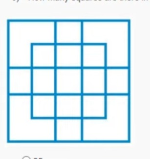

# JOC Jan-2023 · Week 0 : Assignment 1 (Non Graded)

- Source: <https://www.youtube.com/watch?v=7o_LB-etEdA> · SIRAJ TECH SOLUTION · published 2023-02-05
- Portal: `noc23_cs20` (visible in the URL bar); "Your last recorded submission was on 2023-02-05, 09:45 IST"; "Note : This assignment is only for practice purpose and it will not be counted towards the Final score" → **Jan-2023 session**
- **Verified:** the author used "Check Answers and Submit", and the page shows "Yes, the answer is correct." with "Accepted Answers" under every question and "Your score is: 10/10". `[x]` = accepted answer.
- Alternate video for this week (not transcribed): livestream `kmQIk14eCT4`.

**1) If 8 – 8 =63 and 6 – 6 =35 then find the value of 11 – 11=?**
- [ ] 116
- [x] 120
- [ ] 134
- [ ] 128

**2) PARLE is related to QCUPJ in the same way as DABUR is related to \_\_\_\_\_\_.**
- [ ] QDSFA
- [ ] ACIED
- [ ] HEAIS
- [x] ECEYW

**3) A clock shows 5 o'clock in the evening. How many degrees would the hour hand have rotated when the clock shows 11 o'clock at night?**
- [ ] 120
- [ ] 150
- [x] 180
- [ ] 210

**4) What will be the circumference of a circle inscribed inside a square of side 23m ?**
- [ ] 10π
- [ ] 11.5π
- [x] 23π
- [ ] 46π

**5) In a company, 50% of the employees like coffee, 20% like tea, and 10% like both. If 80 employees are working in the company, how many employees like neither coffee nor tea?**
- [ ] 16
- [x] 32
- [ ] 20
- [ ] 24

**6) How many squares are there in the following image?**

- [ ] 25
- [x] 27
- [ ] 28
- [ ] 26

**7) Two notebooks of same price were bought for Rs. 74.8 at a discount of 15%. What is the original price of each of the notebooks ?**
- [ ] 22
- [x] 44
- [ ] 66
- [ ] 11

**8) A metro train 55 meters long is running at a speed of 120 kmph. In what time will it pass a woman who is jogging at 3 kmph in the direction opposite to that in which the train is going?**
- [ ] 2.4 seconds
- [ ] 3.2 seconds
- [x] 1.6 seconds
- [ ] 1.2 seconds

**9) Choose the correct option to fill in the blank.**
**The radius of a wheel is 3m. The wheel rolls 14 times in a minute. To cover a distance of 5.280 km, the wheel will take \_\_\_\_ minutes.**
- [ ] 10
- [x] 20
- [ ] 5
- [ ] 25

**10) Ramesh decides to add tiles to a rectangle-shaped floor that measures 90m x 74m. To add the tiles, the mason charges Rs.11 per sq.m. Find the amount that Ramesh needs to pay the mason.**
- [ ] Rs. 86200
- [x] Rs. 73260
- [ ] Rs. 69480
- [ ] Rs. 84532
