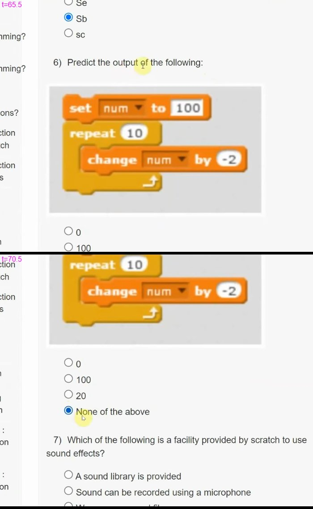

# JOC Jan-2023 · Week 1 : Assignment 1

- Source: <https://www.youtube.com/watch?v=ezwO8G-KifY> · Unique Jankari · published 2023-01-26
- Portal due date shown in video: 2023-02-08, 23:59 IST → **Jan-2023 session**
- `[x]` = option ticked by the video author → unverified

**1) Which of the following is/are control commands in Scratch?**
- [x] repeat
- [x] repeat until
- [x] forever
- [ ] forever until

**2) Which option in scratch is used to wait between the commands:**
- [ ] Event
- [ ] Sensing
- [x] Control
- [ ] Operators

**3) ___________ command is used to make the sprite walk by certain steps.**
- [ ] Hide
- [ ] Delete
- [x] Move
- [ ] Walk

**4) The command used to make the sprite disappear from the animation stage is ____________.**
- [ ] Show
- [x] Hide
- [ ] Delete
- [ ] move

**5) What is the extension of a scratch file?**
- [ ] py
- [ ] Se
- [x] Sb
- [ ] sc

**6) Predict the output of the following:**

- [ ] 0
- [ ] 100
- [ ] 20
- [x] None of the above

**7) Which of the following is a facility provided by scratch to use sound effects?**
- [ ] A sound library is provided
- [ ] Sound can be recorded using a microphone
- [ ] We can use sound file
- [x] None of the above
- [ ] All of the above are correct (except 4).

**8) In addition to an option of using the inbuilt sprite library in scratch, what are the other ways to use a sprite?**
- [ ] We can paint a custom sprite
- [ ] We can use the camera to take pictures
- [ ] We can upload an image from our computer
- [x] All of the above

**9) __________ scratch constructs are used to keep doing a set of instructions infinitely?**
- [ ] ever
- [x] forever
- [ ] never
- [ ] None of the above

**10) Which of the following commands would make the sprite move backward?**
- [ ] Move 10 steps
- [ ] Move -10 steps
- [x] Both 1 and 2
- [ ] Neither 1 and 2
