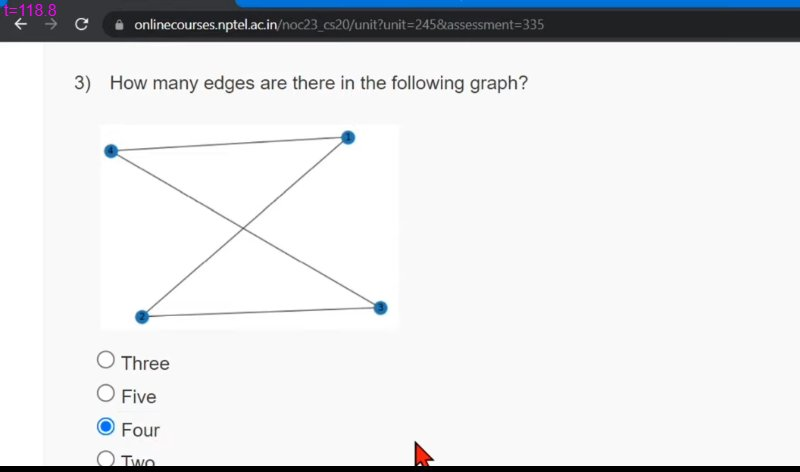
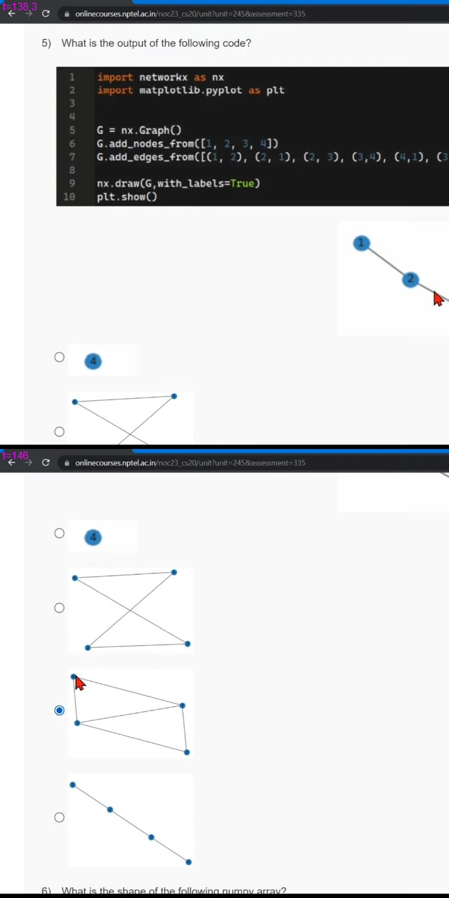
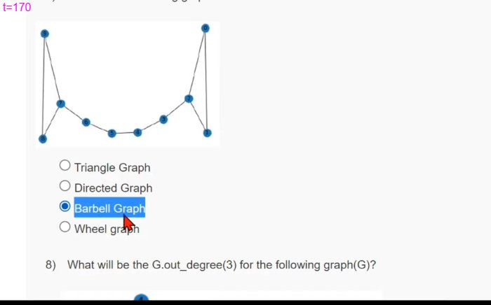
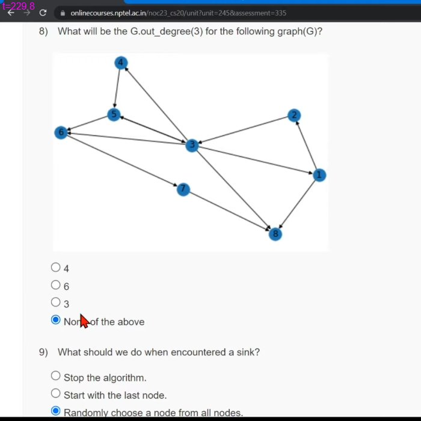
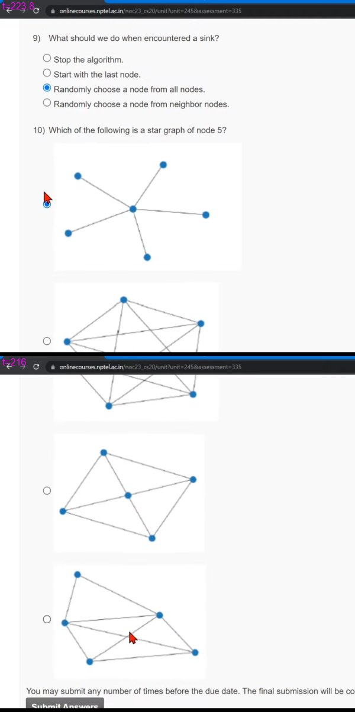

# JOC Jan-2023 · Week 12 : Assignment 12

- Source: <https://www.youtube.com/watch?v=gMq5P6rjftE> · Techies Talk · published 2023-04-09
- Portal: `noc23_cs20`, due 2023-04-19, 23:59 IST → **Jan-2023 session**
- `[x]` = option ticked by the video author → unverified

**1) NLTK ________.**
- [x] Helps to work with human language data.
- [ ] Helps to convert machine data into human language.
- [ ] Helps to work on gibberish language.
- [ ] Helps to translate dog language into human language

**2) The following code will return:**

```python
def test(word):

    new_word = ''

    for ch in word:

        if ch>='a' and ch<='z':

            temp = ord(ch)
            temp = temp - 32
            temp = chr(temp)
            new_word = new_word + temp

    return new_word
```
- [x] Converting lower case letters into upper case.
- [ ] Converting upper case letters into lower case.
- [ ] Return the same word
- [ ] Error

**3) How many edges are there in the following graph?**


- [ ] Three
- [ ] Five
- [x] Four
- [ ] Two

**4) A complete graph will have a degree of separation.**
- [ ] 2
- [x] 1
- [ ] 3
- [ ] Depends on the number of nodes.

**5) What is the output of the following code?**

```python
import networkx as nx
import matplotlib.pyplot as plt


G = nx.Graph()
G.add_nodes_from([1, 2, 3, 4])
G.add_edges_from([(1, 2), (2, 1), (2, 3), (3,4), (4,1), (3,1)])

nx.draw(G,with_labels=True)
plt.show()
```
Options are images — 
- [ ] Option 1 (image: labelled nodes 1–2–3 and 4)
- [ ] Option 2 (image)
- [x] Option 3 (image)
- [ ] Option 4 (image)

**6) What is the shape of the following numpy array?
numpy.array([ [1,2,3], [4,5,6] ])**
- [x] (2,3)
- [ ] (3,2)
- [ ] (3,3)
- [ ] (2,2)

**7) Which is the following graph?**


- [ ] Triangle Graph
- [ ] Directed Graph
- [x] Barbell Graph
- [ ] Wheel graph

**8) What will be the G.out_degree(3) for the following graph(G)?**


- [ ] 4
- [ ] 6
- [ ] 3
- [x] None of the above

**9) What should we do when encountered a sink?**
- [ ] Stop the algorithm.
- [ ] Start with the last node.
- [x] Randomly choose a node from all nodes.
- [ ] Randomly choose a node from neighbor nodes.

**10) Which of the following is a star graph of node 5?**

Options are images — 
- [x] Option 1 (image)
- [ ] Option 2 (image)
- [ ] Option 3 (image)
- [ ] Option 4 (image)
