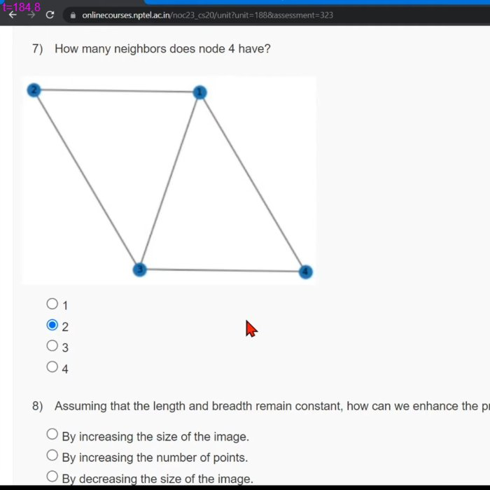

# JOC Jan-2023 · Week 9 : Assignment 1

- Source: <https://www.youtube.com/watch?v=H1719zL0nSY> · Techies Talk · published 2023-03-18
- Portal: `noc23_cs20`, due 2023-03-29, 23:59 IST → **Jan-2023 session**
- `[x]` = option ticked by the video author → unverified

**1) How can we identify which book is written by which author?**
- [ ] By matching handwriting.
- [x] By analyzing word length distribution with previous books.
- [ ] By analyzing the number of pages in a book.
- [ ] By analyzing the book's preface.

**2) Is it guaranteed that the following code snippet will consistently yield a True result?**

```python
G = nx.gnp_random_graph(10, 0.5)
print(nx.is_connected(G))
```
(image shows only lines 4–5 of the snippet)
- [ ] True
- [x] False
- [ ] It will return neither True nor False
- [ ] It will thow an error

**3) What are the different methods available in Python for generating a string?**
- [ ] By using single quotes.
- [ ] By using double quotes.
- [ ] By using triple quotes.
- [x] All of the above

**4) A complete graph will have __ degree of separation**
- [x] 1
- [ ] 2
- [ ] 3
- [ ] Depends on the number of nodes.

**5) Networkx in pythons is used for**
- [x] Making networks
- [x] Analyzing networks
- [x] Visualizing networks
- [ ] Breaking networks

**6) In the world, on average, how many hops will it take to connect two people?**
- [x] 6
- [ ] 7
- [ ] 8
- [ ] 9
- [ ] 10

**7) How many neighbors does node 4 have?**


- [ ] 1
- [x] 2
- [ ] 3
- [ ] 4

**8) Assuming that the length and breadth remain constant, how can we enhance the precision of the calculated area for a state?**
- [ ] By increasing the size of the image.
- [x] By increasing the number of points.
- [ ] By decreasing the size of the image.
- [ ] By decreasing the number of points.

**9) Degree of separation is equivalent to**
- [ ] Number of nodes in a graph
- [ ] Number of edges in a graph
- [x] The average length of the shortest path in a graph
- [ ] None of the above

**10) While calculating the area of Punjab, which of the following will help in more accurate results.**
- [x] More points landed in the Punjab region.
- [ ] More points landed outside the Punjab.
- [ ] More points on the overall map.
- [ ] None of the above.
