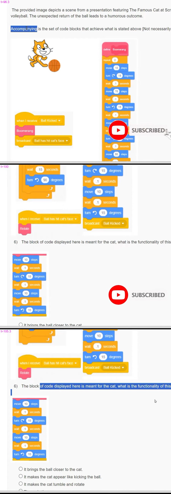
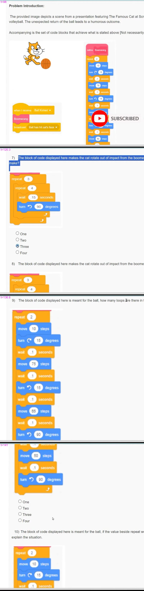

# JOC Jan-2024 · Week 1: Assignment 1

- Source: <https://www.youtube.com/watch?v=a49WzNDFk2Q> · Ateeq10 · published 2024-01-21
- Portal: `noc24_cs57`, due 2024-02-07, 23:59 IST → **Jan-2024 session**
- `[x]` = option ticked by the video author before submitting → unverified (only "Thank you for taking the Week 1 : Assignment 1" is shown, no score)

**1) Which of the following best defines a variable in programming?**
- [ ] A constant value that cannot be changed during program execution.
- [x] A named storage location that can hold varying data during program execution.
- [ ] An operation that performs arithmetic calculations on data.
- [ ] A reserved word is used to define a function or method in a program.

**2) Humans easily get bored doing a repetitive job. However, computers are masters of iteration. In programming, we get a control structure that allows a set of instructions to be executed repeatedly based on a condition. It enables automating repetitive tasks by iterating through a block of code until a specific condition is met or for a defined number of times. What is this control structure called?**
- [ ] Variable
- [ ] Operator
- [x] Loop
- [ ] Data Type

**3) Programming logic is different from programming language. Programming languages are many, but programming logic almost remains the same across all programming languages. Which of the following is programming logic?**
- [ ] Python
- [ ] C
- [ ] C++
- [x] None of the above

**4) Open-source software, unlike proprietary software, is computer software developed through public, collaborative efforts and made freely available to the public. Which of the following programming languages is/are open source?**
- [x] Java
- [x] Python
- [x] FORTRAN
- [ ] Perl

**5) Knowing how to write a piece of code could help us get things done fast. Choose the areas where we can implement coding.?**
- [x] Physics
- [x] Mathematics
- [x] Economics
- [ ] Small Scale Business

---

**Problem Introduction:**

The provided image depicts a scene from a presentation featuring The Famous Cat at Scratch attempting to play football with a Boomerang ball disguised as a volleyball. The unexpected return of the ball leads to a humorous outcome.

Accompanying is the set of code blocks that achieve what is stated above [Not necessarily in sequence of execution]. Answer the questions that follow:

(Scratch blocks visible in the recording; part of `define Boomerang` is covered by a "SUBSCRIBED" overlay — see image and Q9/Q10 below for the full ball script)
- `when I receive [Ball Kicked ▾]` → `Boomerang` → `broadcast [Ball has hit cat's face ▾]`
- `when I receive [Ball has hit cat's face ▾]` → `Rotate`
- `define Boomerang` → `repeat (2)` { `move (10) steps` · `turn ↻ (15) degrees` · `wait (.1) seconds` · `move (75) steps` · `wait (.1) seconds` · `turn ↺ (15) degrees` · `wait (.1) seconds` · `move (65) steps` · `wait (.1) seconds` · `turn ↺ (90) degrees` · `wait (.1) seconds` · `move (50) steps` · `wait (.1) seconds` · `turn ↺ (90) degrees` }
- a cat script ending: … `wait (1) seconds` · `turn ↻ (15) degrees` · `wait (1) seconds` · `move (10) steps` · `wait (1) seconds` · `turn ↺ (15) degrees` · `broadcast [Ball Kicked ▾]`
- `Rotate` (define block, top cut off): `repeat (3)` { `repeat (4)` { `wait (.15) seconds` · `turn ↺ (90) degrees` } }

**6) The block of code displayed here is meant for the cat, what is the functionality of this code?**

(Scratch blocks: `move (10) steps` · `wait (1) seconds` · `turn ↻ (15) degrees` · `wait (1) seconds` · `move (10) steps` · `wait (1) seconds` · `turn ↺ (15) degrees` — wait values read as "1"; may be ".1", see image)
- [ ] It brings the ball closer to the cat.
- [x] It makes the cat appear like kicking the ball.
- [ ] It makes the cat tumble and rotate
- [ ] The code throws an error.

**7) The block of code displayed here makes the cat rotate out of impact from the boomeranging ball, how many complete rotations does the cat make?**

(Scratch blocks: `repeat (3)` { `repeat (4)` { `wait (.15) seconds` · `turn ↺ (90) degrees` } })
- [ ] One
- [ ] Two
- [x] Three
- [ ] Four

**8) The block of code displayed here makes the cat rotate out of impact from the boomeranging ball, how many loops are there in total?**

(same blocks as Q7: `repeat (3)` { `repeat (4)` { `wait (.15) seconds` · `turn ↺ (90) degrees` } })
- [ ] One
- [x] Two
- [ ] Three
- [ ] Four

**9) The block of code displayed here is meant for the ball, how many loops are there in total?**

(Scratch blocks: `repeat (2)` { `move (10) steps` · `turn ↻ (15) degrees` · `wait (.1) seconds` · `move (75) steps` · `wait (.1) seconds` · `turn ↺ (15) degrees` · `wait (.1) seconds` · `move (65) steps` · `wait (.1) seconds` · `turn ↺ (90) degrees` · `wait (.1) seconds` · `move (50) steps` · `wait (.1) seconds` · `turn ↺ (90) degrees` } — "65" could be "55"/"85", blurry; see image)
- [ ] One
- [x] Two
- [ ] Three
- [ ] Four

**10) The block of code displayed here is meant for the ball, if the value beside repeat would have been 1 instead of 2, Select all the statements that explain the situation.**

(same ball script as Q9, `repeat (2)`)
- [x] The Ball would not have returned to Cat.
- [x] Removing the loop from the code would have made no difference in the result.
- [ ] The Ball would not have left its original position.
- [ ] The code would throw an error
