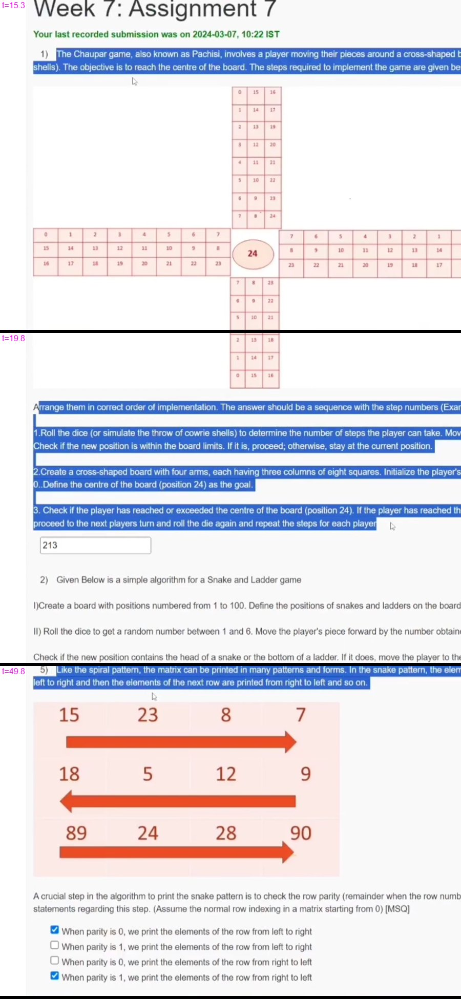

# JOC Jan-2024 · Week 7: Assignment 7

- Source: <https://www.youtube.com/watch?v=Wj_71Ms_9GI> · Study_Ease · published 2024-03-07
- Portal: `noc24_cs57`, due 2024-03-13, 23:59 IST → **Jan-2024 session**
- `[x]` = option ticked / value entered by the video author ("Your last recorded submission was on 2024-03-07, 10:22 IST") → unverified, no score shown

**1) The Chaupar game, also known as Pachisi, involves a player moving their pieces around a cross-shaped board based on the throw of dice (or cowrie shells). The objective is to reach the centre of the board. The steps required to implement the game are given below**



(Board image: a cross with four arms, each three columns of eight squares numbered 0–23 along the path, centre square "24".)

**Arrange them in correct order of implementation. The answer should be a sequence with the step numbers (Example :132)**

**1.Roll the dice (or simulate the throw of cowrie shells) to determine the number of steps the player can take. Move the player's piece based on the dice roll. Check if the new position is within the board limits. If it is, proceed; otherwise, stay at the current position.**

**2.Create a cross-shaped board with four arms, each having three columns of eight squares. Initialize the player's position to be inside the board at position 0. Define the centre of the board (position 24) as the goal.**

**3. Check if the player has reached or exceeded the centre of the board (position 24). If the player has reached the centre, declare them the winner. If not, proceed to the next players turn and roll the die again and repeat the steps for each player**

Answer entered: `213`

**2) Given Below is a simple algorithm for a Snake and Ladder game**

**I)Create a board with positions numbered from 1 to 100. Define the positions of snakes and ladders on the board. Each snake or ladder connects two positions.**

**II) Roll the dice to get a random number between 1 and 6. Move the player's piece forward by the number obtained from the dice roll.**

**Check if the new position contains the head of a snake or the bottom of a ladder. If it does, move the player to the corresponding position as per the snake or ladder.**

**III)Check if the player has reached or exceeded position 100. If the player has reached or exceeded 100 declare them the winner. If not, proceed to the next player's turn. Repeat the process for each player's turn until a player wins.**

**The following variations were suggested for the algorithm.**

**A. If we are using a octahedral dice instead of a normal die, Step II) has to be changed to generate a random number between 1 and 8**

**B. Modification is required only in step I) if we use a board consisting of 200 tiles instead of 100**

**C. Modification is required in both steps I) and III) if we use a board consisting of 200 tiles instead of 100**

**Identify the correct Statements**
- [x] A and B
- [ ] Only B
- [ ] A and C
- [ ] Only C

**3) 3. Nishan enjoys the game of snake and ladders but feels that the player should be given an extra chance if the player lands on a prime numbered tile (Assume that no prime-numbered tile has a snake or ladder in it).**

**He generates the following function is_prime(position) to check if the position of the player is prime or not. However, there is a chance that there could be a small error in the code. Identify the line number corresponding to the error, in the absence of an error answer -1**

```python
1  def is_prime(position):
2      if position<=2 :
3          return False
4      for i in range(2,int(position**0.5)+1):
5          if position%i == 0 :
6              return False
7      return True
```
Answer entered: `2`

**4) Find the error in the line of code written using the library turtle to draw a square. In the absence of an error enter the answer as -1.**

```python
1  import turtle
2
3  screen=turtle.Screen()
4
5  squ = turtle.Turtle()
6
7  for i in range(3):
8      squ.forward(100)
9      squ.right(90)
```
Answer entered: `7`

**5) Like the spiral pattern, the matrix can be printed in many patterns and forms. In the snake pattern, the elements of the row are first printed from left to right and then the elements of the next row are printed from right to left and so on.**

(Image: 3×4 matrix with arrows — row 0 `15 23 8 7` →, row 1 `18 5 12 9` ←, row 2 `89 24 28 90` →; see image above)

**A crucial step in the algorithm to print the snake pattern is to check the row parity (remainder when the row number is divided by 2). Identify the correct statements regarding this step. (Assume the normal row indexing in a matrix starting from 0) [MSQ]**
- [x] When parity is 0, we print the elements of the row from left to right
- [ ] When parity is 1, we print the elements of the row from left to right
- [ ] When parity is 0, we print the elements of the row from right to left
- [x] When parity is 1, we print the elements of the row from right to left

**6) Which of these conditions guarantee that the element is a boundary element of the matrix of order m by n? Take i as the row index and j as the column index of the element of to be checked [MSQ]**
- [x] i==0
- [x] i== m-1
- [x] j==0
- [x] j==n-1

**7) Given a set of 4 integers as input, the following code tries to print the elements in the form of a square matrix of order 2 . But the code might contain errors. Identify the line number corresponding to the error, In the absence of an error give your answer as -1**

```python
1   print("Enter 4 integers, 1 in each line")
2   numbers = []
3   for i in range(4):
4       numbers.append(int(input()))
5
6   matrix=[[],[]]
7   matrix[0] = numbers[:2]
8   matrix[1]= numbers[2:]
9
10  for row in matrix :
11      for element in row:
12          print(element, end=" ")
13      print()
```
Answer entered: `-1`

**8) How can you write data to a CSV file using the \`csv\` module?**
- [ ] \`write_csv_file()\`
- [x] \`csv.writer()\`
- [ ] \`csv.write()\`
- [ ] \`write_csv()\`

**9) Which object is commonly used for reading rows from a CSV file in Python?**
- [ ] \`csv.parser\`
- [ ] \`csv.handler\`
- [x] \`csv.reader\`
- [ ] \`csv.iterator\`

**10) Identify the correct statement(s) regarding the gmplot library**

**I) gmplot is a Python library that allows you to plot data on Google Maps.**
**II) The syntax for creating a base map with gmplot is**
**gmplot.GoogleMapPlotter(latitude, longitude, zoom)**
**the parameters are the geographical coordinates i.e., Latitude and Longitude and the zoom resolution**
- [ ] I only
- [ ] II only
- [x] Both I and II
- [ ] Neither I nor II
