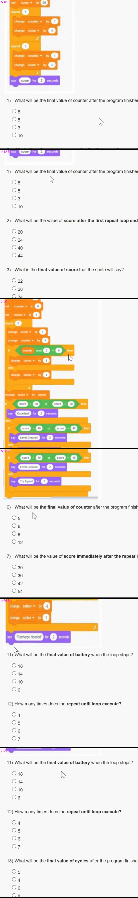

# JOC Jan-2026 · Week 1: Assignment 1

- Source: <https://www.youtube.com/watch?v=pD9ldeXkrKY> · NPTEL Solver · published 2026-01-17
- Portal: due 2026-02-04 (partly hidden by a "SUBSCRIBE" overlay) → **Jan-2026 session**
- `[x]` = option ticked by the video author before submitting → unverified (no score shown). The author left Q1, Q5, Q10 and Q15 **unticked** in every frame.
- Scratch scripts are small and blurry in the 1080p recording: 

**Rohan is learning how to build simple games using the Scratch editor. He creates a sprite and names it Robo. Robo is placed at the centre of the stage and is programmed to perform actions repeatedly while keeping track of numbers on the screen.**

**Rohan wants Robo to count actions and update a score while the program runs. For this purpose, he creates two variables:**
- **counter**
- **score**

**Both variables are shown on the stage so their values can be seen while the program is running.**

**When Rohan clicks the green flag, Robo starts executing the program step by step**

(Scratch blocks: `when ⚑ clicked` · `set [counter] to (0)` · `set [score] to (20)` · `repeat (5)` { `change [counter] by (1)` · `change [score] by (4)` } · `repeat (3)` { `change [counter] by (1)` · `change [score] by (-6)` } · `say (score) for (2) seconds`)

**1) What will be the final value of counter after the program finishes execution?**
- [ ] 8
- [ ] 5
- [ ] 3
- [ ] 10

**2) What will be the value of score after the first repeat loop ends?**
- [ ] 20
- [ ] 24
- [x] 40
- [ ] 44

**3) What is the final value of score that the sprite will say?**
- [x] 22
- [ ] 28
- [ ] 34
- [ ] 40

**4) How many times in total is the change counter by 1 block executed?**
- [ ] 3
- [ ] 5
- [ ] 6
- [x] 8

**5) Which statement is TRUE about the execution of this Scratch program?**
- [ ] The value of score is reset before the second loop
- [ ] The second loop runs before the first loop
- [ ] The sprite says the value of score only once
- [ ] The variable counter is updated only in one loop

---

**Arjun is developing a practice game in the Scratch editor to test how well players perform across multiple rounds. The game uses a sprite named Runner, which earns points as the game progresses and decides the final result based on the total performance.**

**To manage the game, Arjun creates three variables: score, counter, and bonus. The variable score represents the total points earned by the player. The variable counter keeps track of how many rounds have been completed. The variable bonus stores extra points that may be added based on how the rounds progress.**

**When the green flag is clicked, the game begins with fixed starting values. Runner then goes through a fixed number of rounds. In each round, the values of the variables change, and additional checks are performed during the game rather than only at the end. Depending on how the rounds proceed, the bonus value may increase differently in different situations.**

**After all rounds are completed, the total bonus is added to the score. Only then does the game decide which message should be displayed on the screen. The sprite can display only one of the final messages, and this decision depends entirely on the final value of score.**

**While the game is running, all three variables are visible on the stage, allowing the player to observe how their values change. However, the final message shown by the sprite cannot be predicted without carefully tracing the Scratch code, keeping track of the variable values at each stage, and evaluating the conditions at the end of execution.**

(Scratch blocks: `set [score] to (12)` · `set [counter] to (0)` · `set [bonus] to (0)` · `repeat (6)` { `change [score] by (5)` · `change [counter] by (1)` · `if <((counter) mod (2)) = (0)> then` { `change [bonus] by (3)` } `else` { `change [bonus] by (1)` } } · `change [score] by (bonus)` · `if <<(score) > (50)> or <(score) = (50)>> then` { `say [Excellent!] for (2) seconds` } `else` { `if <<(score) > (40)> or <(score) = (40)>> then` { `say [Level Cleared!] for (2) seconds` } `else` { `say [Try Again!] for (2) seconds` } })

**6) What will be the final value of counter after the program finishes execution?**
- [ ] 5
- [x] 6
- [ ] 8
- [ ] 12

**7) What will be the value of score immediately after the repeat loop ends (before adding bonus)?**
- [ ] 30
- [ ] 36
- [x] 42
- [ ] 54

**8) What will be the final value of bonus after the loop completes?**
- [ ] 6
- [ ] 9
- [x] 12
- [ ] 15

**9) What is the final value of score after the bonus is added?**
- [ ] 42
- [ ] 48
- [ ] 50
- [x] 54

**10) What message will the sprite display at the end of the program?**
- [ ] Excellent!
- [ ] Level Cleared!
- [ ] Try Again!
- [ ] No message

---

**Kabir is creating a small simulation using the Scratch editor to understand how devices behave when their battery level changes over time. In this simulation, a sprite represents a device that consumes battery power as it continues to operate.**

**Kabir creates two variables named battery and cycles, and keeps both visible on the stage. The variable battery represents the remaining power level of the device, while cycles records how many operation cycles the device completes before shutting down.**

**When the green flag is clicked, the device starts with a certain battery level and begins operating continuously. With each cycle of operation, the battery level decreases and the cycle count increases. The device continues running only as long as sufficient battery power remains**

**Once the battery level falls to a critical point, the device immediately stops operating and displays a message indicating tha[t it needs] to be recharged. Students observing the simulation can see the battery level and cycle count changing on the stage, but the exact number of cycles completed before shutdown cannot be known without carefully tracing the Scratch program.** *(two words hidden by the SUBSCRIBE overlay)*

**The moment at which the simulation stops depends entirely on the condition used in the loop, making it necessary to understand how Scratch evaluates the stopping condition in a repeat until block.**

(Scratch blocks, small/blurry: `when ⚑ clicked` · `set [battery] to (50)` · `set [cycles] to (0)` · `repeat until <<(battery) < (10)> or <(battery) = (10)>>` { `change [battery] by (-8)` · `change [cycles] by (1)` } · `say ["Recharge Needed"] for (2) seconds`)

**11) What will be the final value of battery when the loop stops?**
- [ ] 18
- [ ] 14
- [x] 10
- [ ] 6

**12) How many times does the repeat until loop execute?**
- [ ] 4
- [x] 5
- [ ] 6
- [ ] 7

**13) What will be the final value of cycles after the program finishes?**
- [x] 5
- [ ] 4
- [ ] 6
- [ ] 8

**14) Which statement about the repeat until block is TRUE in Scratch?**
- [ ] The loop always runs at least once
- [ ] The loop checks the condition after executing the body
- [ ] The loop behaves exactly like repeat n times
- [x] The loop stops immediately if the condition is already true

**15) What message will the sprite display at the end of the program?**
- [ ] Battery Low
- [ ] System Shutdown
- [ ] Recharge Needed
- [ ] No message
