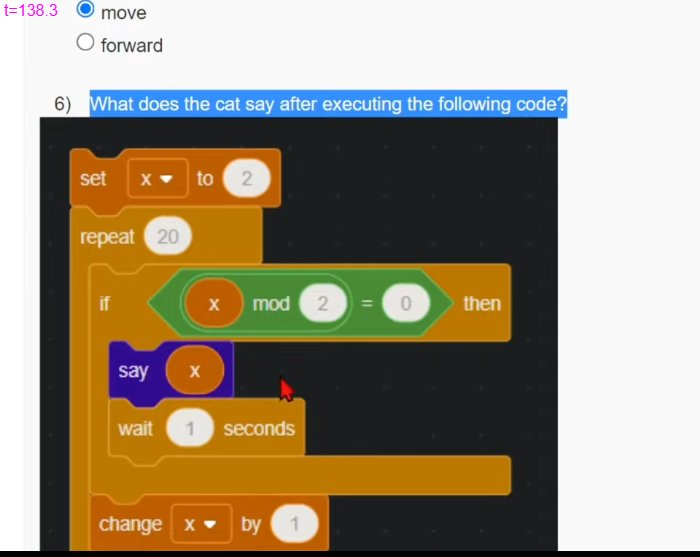

# JOC Jul-2022 · Week 1: Assignment 1

- Source: <https://www.youtube.com/watch?v=b7PDFi9HnyQ> · Techies Talk · published 2022-07-18
- Portal: `noc22_cs122`, due 2022-08-10, 23:59 IST → **Jul-2022 session**
- `[x]` = option ticked by the video author before submitting → unverified

**1) What are the functions that can be performed on the variables?**
- [ ] Rename
- [ ] Delete
- [ ] Initialize starting value
- [x] All of the above

**2) Which of the following statements is true?**
- [x] One can run an infinite loop.
- [ ] One cannot change the value of a variable.
- [ ] One cannot add sound in scratch.
- [ ] One cannot change the size of the image.

**3) Choose the odd one out.**
- [ ] If
- [ ] Repeat
- [x] hide
- [ ] Wait

**4) Which command can be used to decrease the size of a sprite?**
- [x] Set size by
- [ ] Change size by
- [ ] Decrease size
- [ ] Size change by

**5) Which command can be used to move an object by some steps?**
- [ ] rotate
- [ ] turn
- [x] move
- [ ] forward

**6) What does the cat say after executing the following code?**

(Scratch blocks as shown: `set [x] to (2)` → `repeat (20)` { `if <((x) mod (2)) = (0)> then` { `say (x)` · `wait (1) seconds` } · `change [x] by (1)` })
- [ ] All-natural numbers between 1-20. (Both inclusive)
- [x] All even numbers between 1-20. (Both inclusive)
- [ ] All odd numbers between 1-20. (Both inclusive)
- [ ] All whole numbers between 0-20. (Both inclusive)

**7) Which of the following command is not related to the motion section?**
- [ ] if
- [x] wait
- [ ] move
- [ ] rotate

**8) Which command can be used to make an image reappear?**
- [ ] hide
- [ ] reappear
- [x] show
- [ ] glide

**9) Which of the following command is used to take the absolute value of a number?**
- [ ] absolute of
- [x] abs of
- [ ] mod of
- [ ] modulus of

**10) State True or False: In scratch one can mention x and y coordinates to move an image.**
- [x] True
- [ ] False
