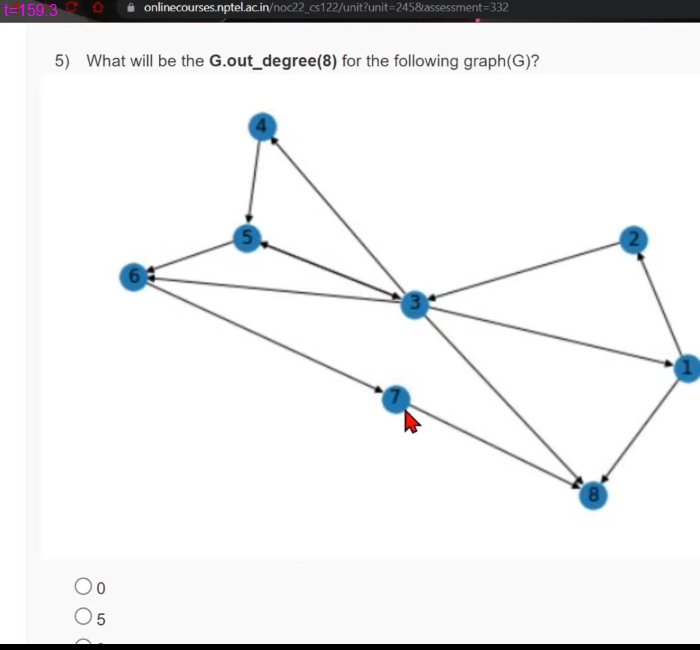

# JOC Jul-2022 · Week 12: Assignment 12

- Source: <https://www.youtube.com/watch?v=PSLOJt72Ipg> · Techies Talk · published 2022-10-09
- Portal: `noc22_cs122`, due 2022-10-19, 23:59 IST → **Jul-2022 session**
- `[x]` = option ticked by the video author before submitting → unverified

**1) State True or False:**
**The number of people referring a person matters over who is referring a person.**
- [ ] True
- [x] False

**2) Which of the following is true about page rank?**
- [x] Websites are nodes and hyperlinks in websites are edges.
- [ ] Hyperlinks in websites are nodes and websites are edges.
- [ ] Websites will work as nodes and edges.
- [ ] Hyperlinks will work as nodes and edges.

**3) What is a drunkard's walk?**
- [ ] Strategised walking
- [ ] Walking one step at a time.
- [x] Random walking
- [ ] Zig zag walking

**4) Given a set of networks, which node in that network is considered as most impressive?**
- [ ] Node with maximum incoming edges.
- [x] Node with maximum visits.
- [ ] Node with minimum incoming edges.
- [ ] Node with minimum visits.

**5) What will be the G.out_degree(8) for the following graph(G)?**

- [x] 0
- [ ] 5
- [ ] 3
- [ ] 6

**6) Which of the following is true about undirected graphs?**
- [x] One can come back and forth from one node to another using a single edge.
- [ ] One can only go forward from one node to another using a single edge.
- [ ] One can go to any node from one node using one edge.
- [ ] None of the above.

**7) which of the following statements will choose a random node from graph A?**
- [ ] random.choices(A)
- [ ] random.choices(A.nodes())
- [x] random.choice(A.nodes())
- [ ] random.choice(A)

**8) which of the following is not true about collatz conjecture?**
- [ ] Bigger the number, larger the steps it would take to converge.
- [x] The number of steps is independent of the number.
- [ ] Collatz conjecture will always converge.
- [x] Collatz conjecture might or might not converge.

**9) In collatz conjecture, if a number is even then what should be the next step?**
- [x] Divide it by 2
- [ ] Multiply it by 3
- [ ] Multiply it by 3 then add 1
- [ ] Divide it by 2 then add 1

**10) The collatz conversion of 10 looks like**
- [x] 10 5 16 8 4 2 1
- [ ] 10 22 11 8 4 2 1
- [ ] 10 5 16 8 4 2
- [ ] None of the above
