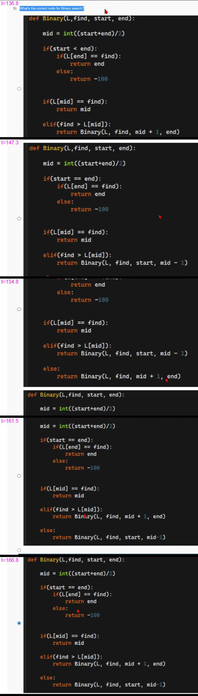

# JOC Jul-2022 · Week 6: Assignment 6

- Source: <https://www.youtube.com/watch?v=pJ2FaIWhizc> · Techies Talk · published 2022-08-27
- Portal: `noc22_cs122`, due 2022-09-07, 23:59 IST → **Jul-2022 session**
- `[x]` = option ticked by the video author before submitting → unverified

**1) In the list L = [4,6,7,4,6,2,1], What is the index of element '7'?**
- [ ] 0
- [ ] 1
- [x] 2
- [ ] 3

**2) Which of the following is true about recursion?**
- [ ] Recursion always performs better than non-recursive code.
- [x] Recursive code is easier to debug
- [x] The base case is necessary for recursion.
- [x] Recursive code can be shorter than non-recursive code.

**3) What will be the output of the following program?**

```python
s = 'AbraKaDabra'
print(s[1:6])
```
- [ ] No output
- [x] braKa
- [ ] Abra
- [ ] rak

**4) What will be the output of the following program?**

```python
def recursive(a):

    if a == 0:
        return 0

    return a+recursive(a-1)

print(recursive(10))
```
- [x] Sum of first 10 natural numbers.
- [ ] Sum of first 9 natural numbers.
- [ ] The program will never end.
- [ ] Sum of numbers from 2-10(Both inclusive).

**5) What's the correct code for Binary search?**

Frames of all four options: 

- [ ] Option 1
  ```python
  def Binary(L,find, start, end):

      mid = int((start+end)/2)

      if(start < end):
          if(L[end] == find):
              return end
          else:
              return -100


      if(L[mid] == find):
          return mid

      elif(find > L[mid]):
          return Binary(L, find, mid + 1, end)

      else:
          return Binary(L, find, start, mid-1)
  ```
- [ ] Option 2
  ```python
  def Binary(L,find, start, end):

      mid = int((start+end)/2)

      if(start == end):
          if(L[end] == find):
              return end
          else:
              return -100


      if(L[mid] == find):
          return mid

      elif(find > L[mid]):
          return Binary(L, find, start, mid - 1)

      else:
          return Binary(L, find, mid + 1, end)
  ```
- [ ] Option 3
  ```python
  def Binary(L,find, start, end):

      mid = int((start+end)/2)

      if(start == end):
          if(L[end] == find):
              return end
          else:
              return -100


      if(L[mid] == find):
          return mid

      elif(find > L[mid]):
          return Binary(L, find, mid + 1, end)

      else:
          return Binary(L, find, start, mid-1)
  ```
- [x] Option 4 *(appears identical to Option 3 in every captured frame — any difference is not visible at video resolution; see image)*
  ```python
  def Binary(L,find, start, end):

      mid = int((start+end)/2)

      if(start == end):
          if(L[end] == find):
              return end
          else:
              return -100


      if(L[mid] == find):
          return mid

      elif(find > L[mid]):
          return Binary(L, find, mid + 1, end)

      else:
          return Binary(L, find, start, mid-1)
  ```

**6) Which of the following can be used to see the dimension of a NumPy array named 'arr'?**
- [ ] dim(arr)
- [ ] shape(arr)
- [x] arr.shape
- [ ] arr.shape()

**7) If PYTHON is encoded by TCXLSR then DIAMOND will be encoded as?**
- [ ] EJBNPOE
- [ ] FKCORPF
- [ ] HMERTSH
- [x] HMEQSRH

**8) Select the correct statement
1) print('9a'.isalnum()) will return True.
2) '9a' contains both alphabetic and numeric parts.**
- [x] Option 1 is correct, option 2 is correct. Option 2 is the correct explanation for option 1.
- [ ] Option 1 is correct, option 2 is incorrect.
- [ ] Option 1 is correct, option 2 is correct. Option 2 is not the correct explanation for option 1.
- [ ] Option 1 is incorrect, option 2 is incorrect.

**9) What will be the output of the following program?**

```python
s = 'Fusce id odio leo In quis laoreet nulla'
d = {}

for i in s:

    d[i]+=1

print(d)
```
- [ ] A dictionary with the count of each character in s.
- [ ] A dictionary with the count of each special character in s.
- [ ] A dictionary with the count of letters in s.
- [x] Error

**10) Let L be a list containing different names of movies. Which statement is correct to select a random movie name from that list L?**
- [x] random.choices(L)
- [ ] random.select(L)
- [ ] random.movie(L)
- [ ] random.random(L)
