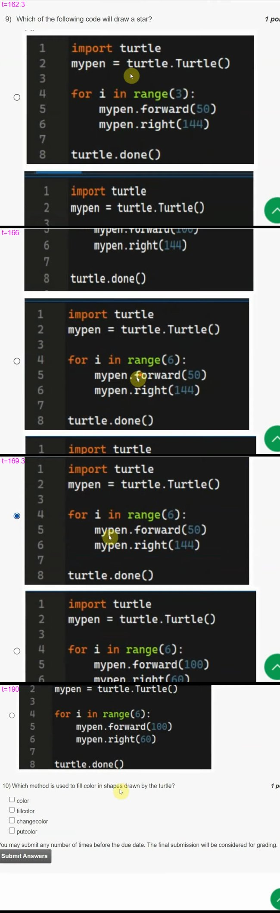

# JOC Jul-2022 · Week 7: Assignment 7

- Source: <https://www.youtube.com/watch?v=kiNlRmQ22h8> · Unique Jankari · published 2022-09-06
- Portal: `noc22_cs122`, due 2022-09-14, 23:59 IST → **Jul-2022 session**
- `[x]` = option ticked by the video author before submitting → unverified

**1) How ladders & snakes are represented by the instructor?**
- [ ] Through lists.
- [ ] Through dictionaries.
- [x] Through if and elif conditions.
- [ ] Through sets.

**2) Which of the following is the correct full form of CSV?**
- [x] Comma separated values.
- [ ] Colon separated values.
- [ ] Semi-Colons separated values.
- [ ] Tab separated values.

**3) Why do we use functions?**
- [x] To improve readability.
- [x] To reuse code blocks.
- [x] For the ease of code debugging.
- [ ] For fun.

**4) In snakes and ladders, what can be the other ways, except for one used by the instructor, to keep track of ladders and snakes?**
- [x] Maintain a dictionary with snakes or ladder number blocks as keys.
- [ ] Using the if condition to check on every number.
- [x] Using lists.
- [ ] None of the above

**5) Which of the following libraries is used for animation?**
- [ ] Matplotlib
- [x] Turtle
- [ ] Random
- [ ] PIL

**6) The spiral animation problem can be broken down into?**
- [ ] A list.
- [x] A 2D table.
- [ ] A 3D table.
- [ ] A dictionary.

**7) What is the purpose of the GPS program shown in the lectures?**
- [ ] To show directions to the user.
- [x] To track the directions of the user.
- [ ] To show the way to the user on maps.
- [ ] None of the above.

**8) What does the following program will do after execution?**

```python
from PIL import image

im = image.open('snakesraw.png')
im.save('snakes.png')
```
- [ ] Rename snakesraw.png as snakes.png
- [ ] Make a copy of snakesraw.png with the name snakes.png
- [ ] Make a copy of snakesraw.png with the name snakes.jpeg
- [x] Throws an error

**9) Which of the following code will draw a star?**

Frames of all four options:  — *the video is 720p, so the digits inside `range()` are read from blurry frames; check the image.*

- [ ] Option 1
  ```python
  import turtle
  mypen = turtle.Turtle()

  for i in range(3):
      mypen.forward(50)
      mypen.right(144)

  turtle.done()
  ```
- [ ] Option 2
  ```python
  import turtle
  mypen = turtle.Turtle()

  for i in range(3):
      mypen.forward(100)
      mypen.right(144)

  turtle.done()
  ```
- [x] Option 3
  ```python
  import turtle
  mypen = turtle.Turtle()

  for i in range(6):
      mypen.forward(50)
      mypen.right(144)

  turtle.done()
  ```
- [ ] Option 4
  ```python
  import turtle
  mypen = turtle.Turtle()

  for i in range(6):
      mypen.forward(100)
      mypen.right(60)

  turtle.done()
  ```

**10) Which method is used to fill color in shapes drawn by the turtle?**
- [ ] color
- [ ] fillcolor
- [ ] changecolor
- [ ] putcolor

> No option was ticked for Q10 in any captured frame (the author switched to a "programming assignment answers" notepad slide after Q9).
