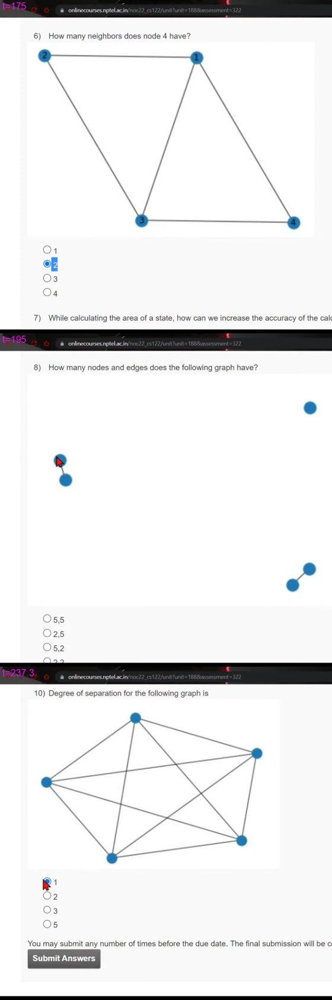

# JOC Jul-2022 · Week 9: Assignment 9

- Source: <https://www.youtube.com/watch?v=fPG7vktKT6Y> · Techies Talk · published 2022-09-21
- Portal: `noc22_cs122`, due 2022-09-28, 23:59 IST → **Jul-2022 session**
- `[x]` = option ticked by the video author before submitting → unverified
- Graph images for Q6, Q8, Q10 (top to bottom): 

**1) Which of the following ways can help to identify the author of a book?**
- [x] Books coverage
- [x] The uniqueness of writing.
- [x] Average word length.
- [ ] Publisher name.

**2) Networkx in pythons is used for**
- [x] Making networks
- [x] Analyzing networks
- [x] Visualizing networks
- [ ] Breaking networks

**3) What is the output of the following program?**

```python
s = 'joc python'
print(list(s))
```
- [ ] ['joc, 'python']
- [ ] ['j', 'o', 'c', 'p', 'y', 't', 'h', 'o', 'n']
- [x] ['j', 'o', 'c', ' ', 'p', 'y', 't', 'h', 'o', 'n']
- [ ] [' ', 'c', 'h', 'j', 'n', 'o', 'o', 'p', 't', 'y']

**4) In the world, on average, how many hops it will take to connect two people?**
- [x] 6
- [ ] 7
- [ ] 8
- [ ] 9
- [ ] 10

**5) In the following code, nx.is_connected(G) will return?**

```python
import networkx as nx

G = nx.gnp_random_graph(5, 1)
```
- [x] True
- [ ] False
- [ ] Sometimes True, sometimes false

**6) How many neighbors does node 4 have?**

(graph image — see first panel of the linked image: nodes 1, 2, 3, 4)
- [ ] 1
- [x] 2
- [ ] 3
- [ ] 4

**7) While calculating the area of a state, how can we increase the accuracy of the calculated area?**
- [ ] By increasing the size of the image.
- [x] By increasing the number of points.
- [ ] By decreasing the size of the image.
- [ ] By decreasing the number of points.

**8) How many nodes and edges does the following graph have?**

(graph image — see second panel of the linked image)
- [ ] 5,5
- [ ] 2,5
- [x] 5,2
- [ ] 2,2

**9) Which function of NLTK is used to make a frequency distribution of words?**
- [ ] freqdist()
- [x] FreqDist()
- [ ] frequency_distribution
- [ ] freq_dist()

**10) Degree of separation for the following graph is**

(graph image — see third panel of the linked image)
- [x] 1
- [ ] 2
- [ ] 3
- [ ] 5
